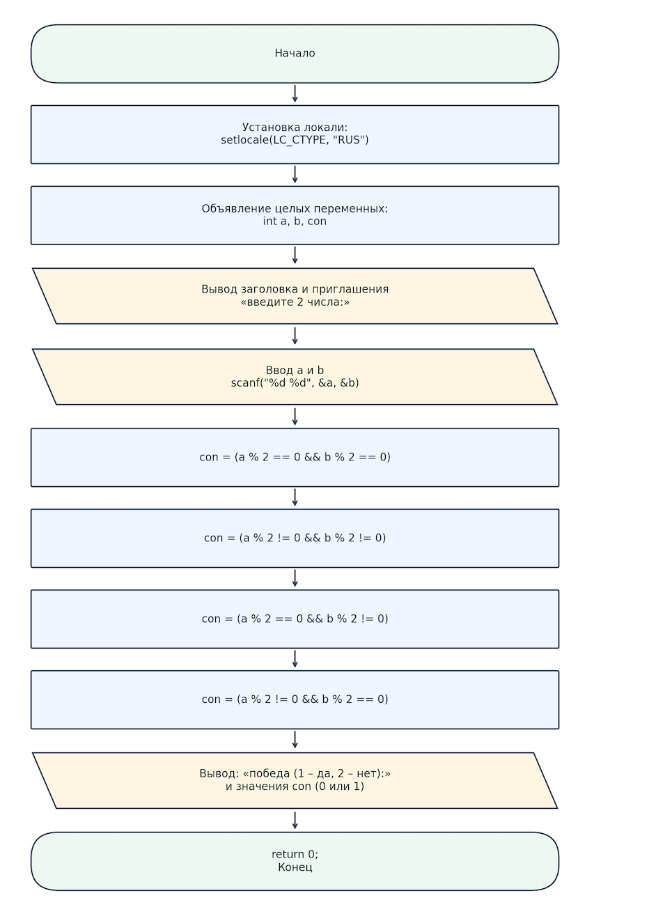

# Домашнее задание к работе 4
## 1.Задача:
На телевикторине два игрока (A и B) нажали на кнопки. Для победы в раунде нужно, чтобы ровно один из них нажал на кнопу с четным номером. Запишите условие победы в раунде.
### 2.Алгоритм
1. Начало.
2. Ввод переменных a,b,con;
3. Присвоение con:
   оба числа чётные;
   оба числа нечётные;
   a чётное, b нечётное;
   a нечётное, b чётное.
4. Вывод con;
### 3.Блок-схема

# 4.Реализация программы

## 5. Информация о разработчике
  Овчинников Артём БИЦТ-262
